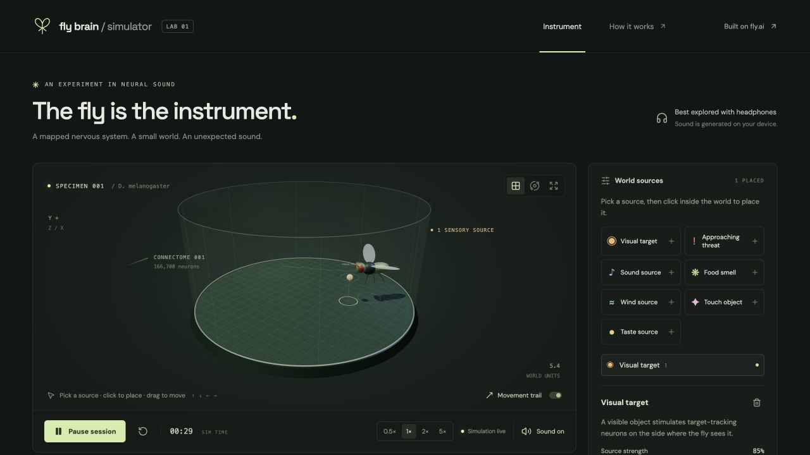
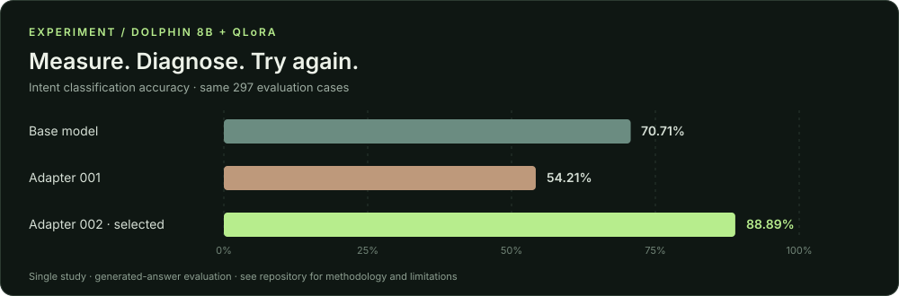

### Hey, I'm Otto 👋

**Senior Software & AI Engineer · AI Agent Platforms & Cloud Infrastructure**

I build **AI agent platforms and cloud infrastructure** for **[Daedalus Design Labs](https://www.linkedin.com/company/100845750/), a San Francisco company**. My work spans the applications people use, the agent systems behind them, and the infrastructure that runs them.

I own **application architecture, infrastructure, and deployments**, working with **AWS / Amazon EKS, Kubernetes, Terraform, and Helm**, alongside **Python / FastAPI** services and **React / Next.js** applications.

**9+ years building software**, including Technical Team Lead at **DEPT®** and Technical Lead at **Agnitu**. I combine hands-on engineering with product decisions, client collaboration, and mentoring engineers.

🌍 Working remotely and building from wherever I land. 
🛡️ Currently studying **cybersecurity**, with an interest in security for AI agent systems.

  
  

### What I work on

| Area | Focus |
| --- | --- |
| **AI & agent platforms** | Agent creation and deployment, orchestration, tool calling, MCP, RAG, LangChain, and LLM evaluation |
| **Cloud & infrastructure** | AWS, Amazon EKS, Kubernetes, Terraform, Helm, Docker, and CI/CD |
| **Architecture & delivery** | Application architecture, distributed systems, end-to-end product delivery, stakeholder demos, and technical mentoring |

### Tools I build with

**AI & backend**

  
  
  
  
  

**Cloud & infrastructure**

  
  
  
  
  
  

**Full-stack applications**

  
  
  
  
  

More of my engineering background

- **Services & integrations:** REST APIs, GraphQL, tRPC, RabbitMQ, Amazon SQS, Flask, C# / .NET Core.
- **Data & cloud:** PostgreSQL, SQL Server, MongoDB, Amazon S3 / RDS / ECS, and Google Cloud Platform.
- **Product engineering:** React Native, payments and Stripe integrations, CI/CD, Jenkins, Jest, and observability.
- **Architecture & leadership:** System design, technical delivery, product development, mentoring, and leading engineering teams.

### Independent builds & experiments

#### 🧠 [Fly Brain Simulator](https://github.com/ottobonilla95/fly-brain-simulator)

A browser-based musical instrument driven by a connectome-based fly neural simulation. **166,700 neurons, 25.1 million connections**, and a small interactive world that turns neural activity into sound.

**TypeScript · React · Three.js · Web Audio**  
[Explore the experiment ↗](https://github.com/ottobonilla95/fly-brain-simulator)

---

#### 🧪 [Dolphin QLoRA Study](https://github.com/ottobonilla95/dolphin-qlora)

Fine-tuning an 8B model on Apple Silicon for customer-support intent classification. The first adapter regressed; a lower learning rate and validation-based checkpoint selection brought accuracy to **88.89% across 297 evaluation cases**.

**Python · MLX · QLoRA · Evaluation**  
[Read the findings and limitations ↗](https://github.com/ottobonilla95/dolphin-qlora/blob/main/EXPERIMENT.md)

### On my radar

- **Agents & AI infrastructure** — orchestration, tools, and dependable execution.
- **Cybersecurity** — building my foundations and exploring security for agent systems.
- **Learning by experiment** — fine-tuning, reinforcement learning, and reproducible results.

Building useful AI. Exploring strange ideas. Sharing what I learn.
