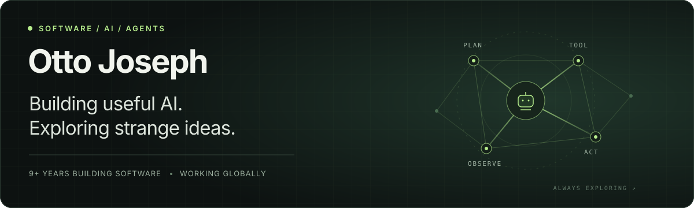

  

### Hey, I'm Otto 👋

Software & AI engineer with **9+ years building full-stack software**. I work for a **San Francisco company** and build from wherever I land. 🌍

My focus is **AI agents, the infrastructure behind them, and applications people can use**. Outside that, you'll find me fine-tuning models, exploring reinforcement learning, or turning a fly's neural activity into sound.

🛡️ **Currently studying cybersecurity**, with a growing interest in how security and agent systems intersect.

  
  

### Tools I build with

  

### Selected builds & experiments

#### 🔎 [JobScout AI](https://github.com/ottobonilla95/jobscoutai)

AI-powered job discovery, CV matching, role research, and application tracking. A working application connecting AI with scheduled workflows.

**TypeScript · Next.js · PostgreSQL · AI workflows**  
[Open the app ↗](https://jobscoutai-phi.vercel.app) · [Explore the code ↗](https://github.com/ottobonilla95/jobscoutai)

---

#### 🧠 [Fly Brain Simulator](https://github.com/ottobonilla95/fly-brain-simulator)

A browser-based musical instrument driven by a connectome-based fly neural simulation. **166,700 neurons, 25.1 million connections**, and a small interactive world that turns neural activity into sound.

**TypeScript · React · Three.js · Web Audio**  
[Explore the experiment ↗](https://github.com/ottobonilla95/fly-brain-simulator)

---

#### 🧪 [Dolphin QLoRA Study](https://github.com/ottobonilla95/dolphin-qlora)

Fine-tuning an 8B model on Apple Silicon for customer-support intent classification. The first adapter regressed; a lower learning rate and validation-based checkpoint selection brought accuracy to **88.89% across 297 evaluation cases**.

**Python · MLX · QLoRA · Evaluation**  
[Read the findings and limitations ↗](https://github.com/ottobonilla95/dolphin-qlora/blob/main/EXPERIMENT.md)

### On my radar

- **Agents & AI infrastructure** — orchestration, tools, and dependable execution.
- **Cybersecurity** — building my foundations and exploring security for agent systems.
- **Learning by experiment** — fine-tuning, reinforcement learning, and reproducible results.

Building useful AI. Exploring strange ideas. Sharing what I learn.
